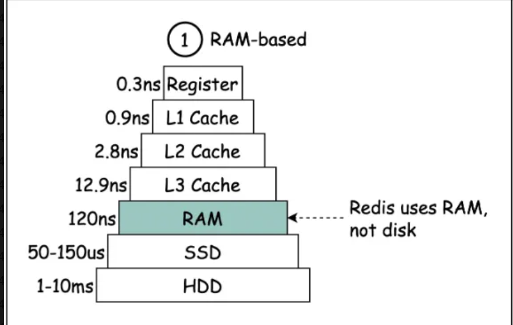
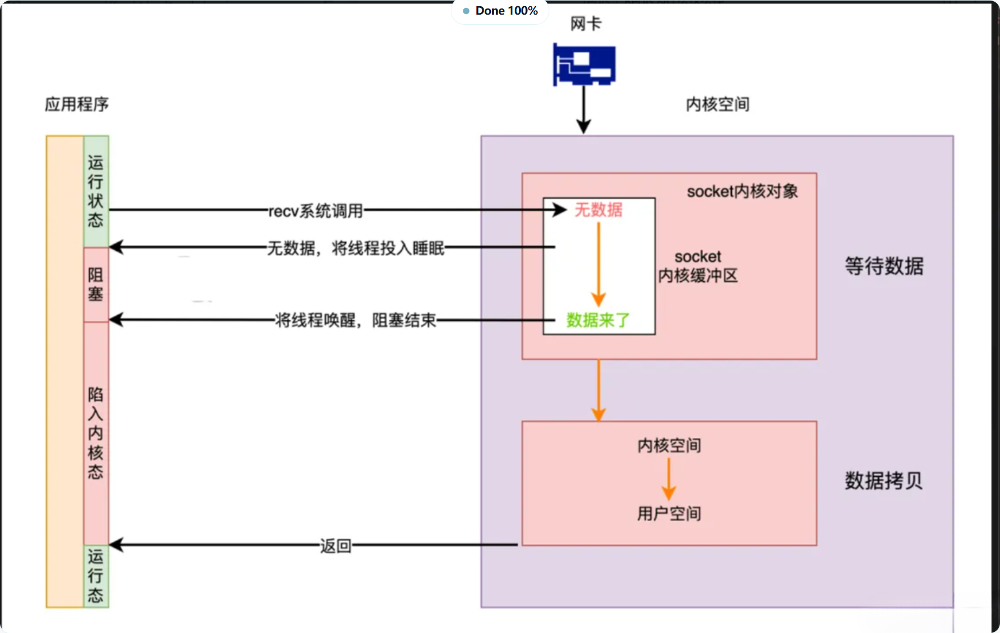
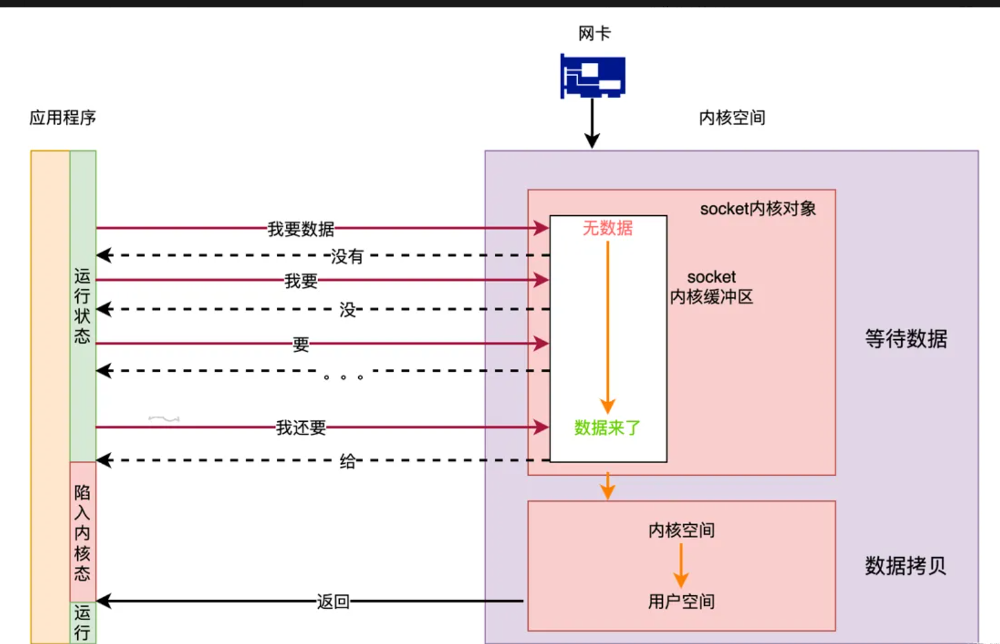
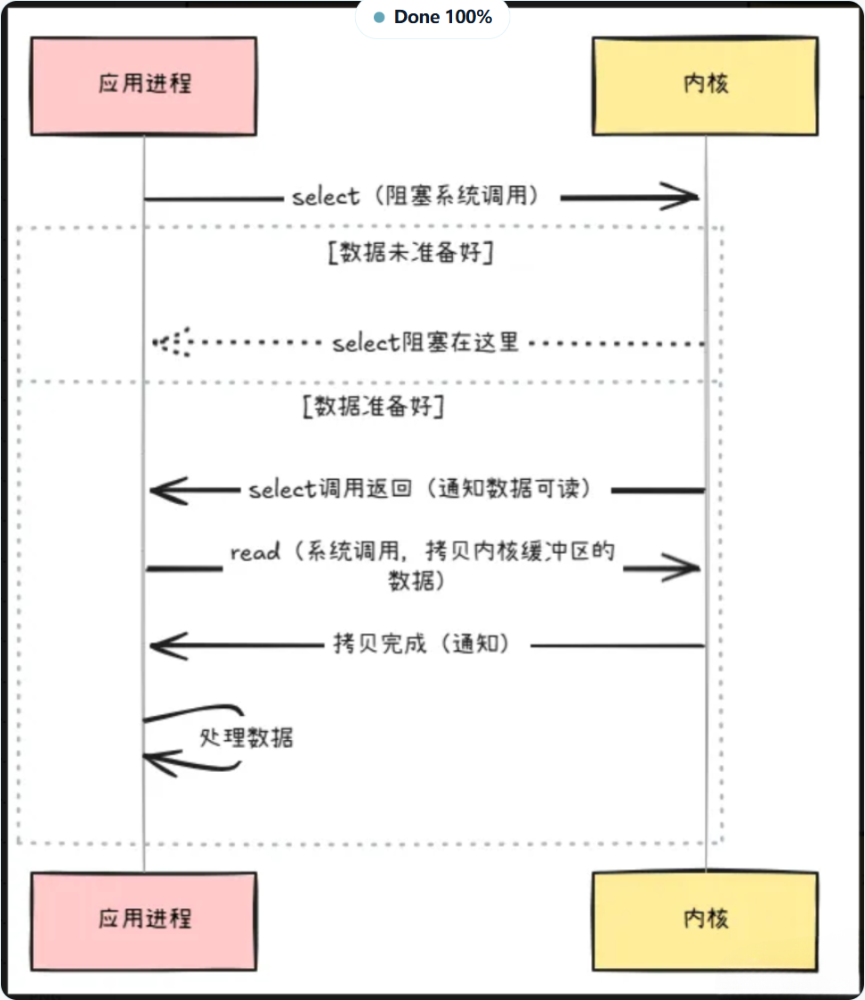
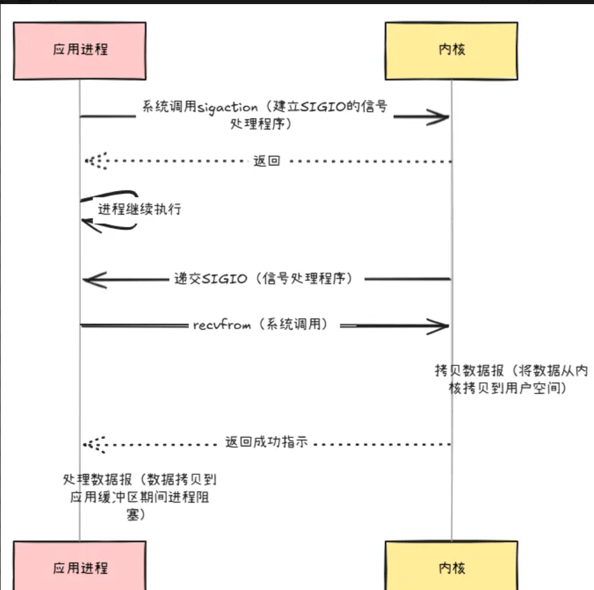
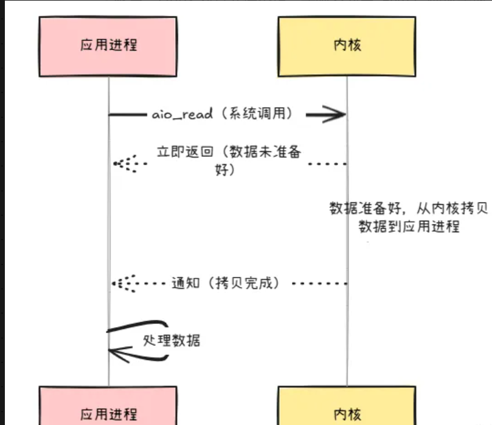

1. **基于内存（重点）**：Redis 是内存数据库，数据存于内存，内存访问速度远快于硬盘，极大提升数据读写速度。
2. **单线程模型（重点）**：采用单线程，所有操作在一个线程内完成，避免线程切换和上下文切换，提高运行效率与响应速度。
3. **多路复用 I/O 模型（重点）**：在单线程基础上运用 I/O 多路复用技术，单个线程能同时处理多个客户端连接，提升并发性能。
4. **高效的数据结构（重点）**：提供哈希表、有序集合、列表等多种高效数据结构，能在 O (1) 时间复杂度内完成数据读写，利于快速处理数据请求。
5. **多线程的引入（重点）**：Redis 6.0 引入多线程机制，提升 IO 性能。能让网络处理请求并发进行，减少网络 I/O 等待影响，还能利用 CPU 多核优势 。

### 扩展内容

1. **存储方式**：Redis 基于内存存储，内存访问速度极快，相比 SSD 磁盘快近千倍，比传统硬盘更快。除持久化等少数场景，多数读写基于内存，大大提升效率。

2. **优秀的线程模型以及 IO 模型**

- **单线程优势**：使用单个主线程执行命令，避免线程切换和上下文切换开销，提高运行效率与响应速度。
- **I/O 多路复用**：采用该技术，单个线程能同时处理多个客户端连接，提升并发能力。
- **多线程引入**：4.0 开始引入如 Unlink 等异步执行命令；6.0 后引入多线程机制，并发处理网络请求，减少网络 I/O 等待影响。
2. **高效的数据结构**：Redis 提供字符串、哈希、Zset 等丰富数据结构，多数操作时间复杂度为 O (1)，能快速完成各种操作 。

#### 为什么Redis单线程也能这么快？

Redis 性能好有多方面原因，其中重要一点是在单线程中使用多路复用 I/O 技术提升 I/O 利用率。

**多路复用技术**：

- Linux 多路复用技术允许多个进程的 I/O 注册到同一管道与内核交互，准备好数据后进程再将其拷贝到用户空间，实现一个线程处理多个 I/O 流。
- Linux 下 I/O 多路复用有 select、poll、epoll 三种，功能类似细节不同。
- Redis 的 I/O 多路复用程序通过包装操作系统的 I/O 多路复用函数库实现功能，每个函数库在源码中有对应文件。
- 在 Redis 中，套接字准备好执行相关操作时会产生文件事件，多个文件事件可能并发出现，请求到达后由 Redis 线程处理，达成一个线程处理多个 I/O 流的效果。

**Redis 高性能的其他原因**：

- 完全基于内存，多数请求为内存操作，速度极快。
- 数据结构简单，操作也简单，如哈希表、跳表性能高。
- 采用单线程，避免上下文切换、竞争条件以及多进程或多线程切换带来的 CPU 消耗 。

#### 说一下常见的五种I/O模型

下面我们讲一个例子先来浅浅谈一下这5个模型IO的做法。

- 从前有一条小河，河里有许多条鱼，一个叫张三的少年就很喜欢钓鱼，他带着自己的鱼竿就去钓鱼了，但张三这个人很固执，只要鱼没上钩，张三就一直等着，什么都不做，死死的盯着鱼漂，只有鱼漂动了，张三才会动，然后把鱼钓上来，钓上来之后，张三就又会重复之前的动作，一动不动的等待鱼儿上钩。
- 而此时走过来一个李四，李四这名少年也很喜欢钓鱼，但李四和张三不一样，李四左口袋装着《Linux高性能服务器编程》，右口袋装着一本《算法导论》，左手拿手机，右手拿了一根鱼竿，李四拿了钓鱼凳坐下之后，李四就开始钓鱼了，但李四不像张三一样，固执的死盯着鱼漂看，李四一会看会儿左口袋的书，一会玩会手机，一会儿又看算法导论，一会又看鱼漂，所以李四一直循环着前面的动作，直到循环到看鱼漂时，发现鱼漂已经动了好长时间了，此时李四就会把鱼儿钓上来，之后继续重复循环前面的动作。
- 此时又来了一个王五少年，王五就拿着他自己的iphone14pro max和一根鱼竿外加一个铃铛，然后就来钓鱼了，王五把铃铛挂到鱼竿上，等鱼上钩的时候，铃铛就会响，王五根本不看鱼竿，就一直玩自己的iphone，等鱼上钩的时候，铃铛会自动响，王五此时再把鱼儿钓上来就好了，之后王五又继续重复前面的动作，只要铃铛不响，王五就一直玩手机，只有铃铛响了，王五才会把鱼钓上来。
- 此时又来了一个赵六的人，赵六和前面的三个人都不一样，赵六是个小土豪，赵六手里拿了一堆鱼竿，目测有几百根鱼竿，赵六到达河边，首先就把几百根鱼竿每隔几米插上去，总共插了好几百米的鱼竿，然后赵六就依次遍历这些鱼竿，哪个鱼竿上的鱼漂动了，赵六就把这根鱼竿上的鱼钓上来，然后接下来赵六就又继续重复之前遍历鱼竿的动作进行钓鱼了。
- 然后又来了一个钱七，钱七比赵六还有钱，钱七是上市公司的CEO，钱七有自己的司机，钱七不喜欢钓鱼，但钱七喜欢吃鱼，所以钱七就把自己的司机留在了岸边，并且给了司机一个电话和一个桶，告诉司机，等你把鱼钓满一桶的时候，就给我打电话，然后我就从公司开车过来接你，所以钱七就直接开车回公司开什么股东大会去了，而他的司机就被留在这里继续钓鱼了。

常见的 I/O 模型有五种，从读取网络数据角度，以演进视角介绍如下：

1. **同步阻塞 I/O（BIO）**：

- **原理**：用户线程调用 `read` 获取网络数据时，需等待网卡接收数据、数据拷贝到内核、再拷贝到用户空间，整个过程线程阻塞。
- **优点**：简单，调用 `read` 后等待数据处理即可。
- **缺点**：一个线程对应一个连接，资源浪费，即便无数据也会阻塞。

2. **同步非阻塞 I/O（NIO）**：

- **原理**：无数据时，用户程序不再阻塞，直接返回错误，通过轮询发起 `read` 调用，数据从内核拷贝到用户空间时会阻塞。
- **优点**：比 BIO 灵活，线程可在无数据时处理其他任务。
- **缺点**：若线程仅处理数据，海量连接下会频繁系统调用，CPU 上下文切换频繁，资源消耗大。

3. **I/O 多路复用**：

- **原理**：使用一个线程监控多个连接是否有数据就绪，通过 `select` 注册监听连接，有数据时通知其他线程 `read` 数据，`read` 仍会阻塞线程。
- **优点**：减少线程数量，降低内存消耗和上下文切换次数。
- **缺点**：`select` 需时刻查询数据就绪状态。

4. **信号驱动式 I/O**：

- **原理**：内核告知数据准备就绪，用户线程再去 `read`（仍会阻塞）。
- **优点**：无需轮询等待数据。
- **缺点**：TCP 协议下，多种事件产生同一信号，应用程序难区分信号来源，基本不可用；UDP 协议下可用。

5. **异步 I/O（AIO）**：

- **原理**：用户线程调用 `aio_read`，内核完成数据从内核到用户空间的拷贝，操作完成后调用回调通知用户线程，全程无阻塞。
- **优点**：真正的非阻塞 I/O。
- **缺点**：Linux 对其支持不足，实际多为用 `epoll` 模拟实现；Windows 实现了真正的 AIO，但服务器多部署在 Linux 上，故主流仍是 I/O 多路复用 。

