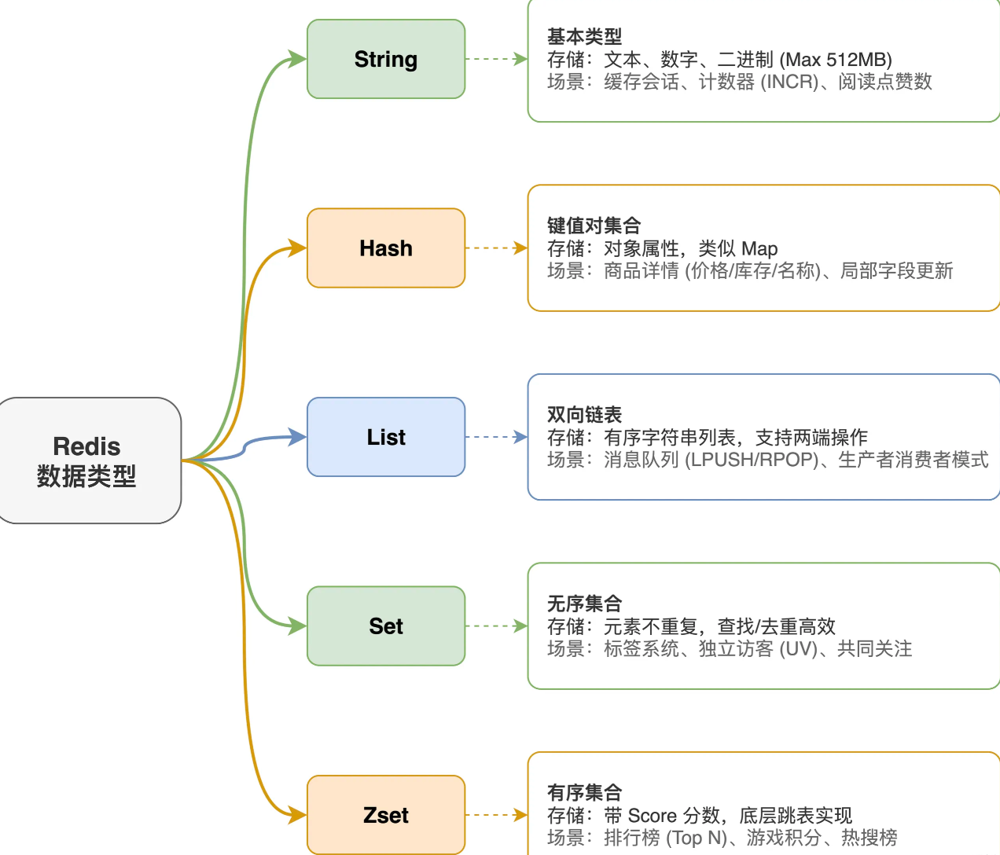

Redis 常见的数据结构主要有五种：String、List、Hash、Set、Zset。
String 是最基本的类型，能存文本、数字、二进制，最大512MB。典型场景就是缓存用户会话、页面数据，或者做计数器，比如文章阅读量、点赞
数，直接用INCR原子递增就行。
Hash 本质上是个键值对集合，特别适合存对象属性。比如存商品详情，商品ID作为key，价格、库存、名称这些字段都塞进一个Hash 里，改单个字
段不用整体覆盖。
List 是有序的字符串列表，底层是双向链表，支持两端操作。最常用的场景就是消息队列，LPUSH 生产消息，RPOP 消费消息，简单的生产者消费者
模式就搞定了。
Set 是无序且元素不重复的集合，查找和去重效率很高。适合做标签系统、记录某个页面的独立访客、共同关注等需要去重或集合运算的场景。
Zset 跟Set 类似，但每个元素都带一个 score 分数用来排序，底层用跳表实现。最典型的就是排行榜，比如游戏积分榜、热搜榜，按 score 排序后
直接取 Top N。